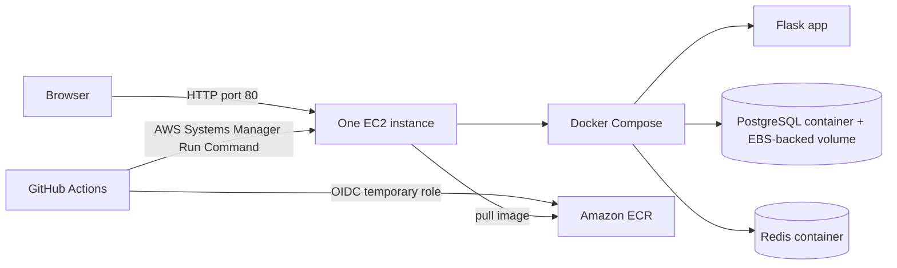

# Deploy Linkdrop to one EC2 instance with Docker Compose

This guide explains the lower-cost learning deployment: one small EC2 instance runs Flask, PostgreSQL, and Redis together with Docker Compose. GitHub Actions builds the Flask image and deploys it through AWS Systems Manager. GitHub gets short-lived AWS credentials through OIDC; the workflow stores no permanent AWS access key.

> **Status:** The Terraform files and GitHub Actions workflow are prepared. The AWS account has a zero-spend budget alert, but no deployment infrastructure has been created yet. The account is currently on its Free plan; check its plan status and credits before deploying. The app instance, EBS disk, ECR storage, and network traffic use AWS resources. Stop the instance for short breaks and terminate it when the test is over.

## Architecture



The instance uses an encrypted 16 GiB gp3 root volume. PostgreSQL data lives in a Docker named volume on that disk. Port 80 is public for the demo. SSH is closed; the workflow and operator access use Systems Manager. The database and Redis ports are not published to the internet. This is a single-server learning setup without high availability or HTTPS.

## Cost controls

- Terraform defaults to a `t3.micro` in `ap-south-1` (Mumbai), no NAT Gateway, no load balancer, no managed RDS, and no managed cache. The GitHub Actions standard runner is free for public repositories, subject to GitHub’s current usage policy.
- AWS charges for the EC2 instance while it runs, its EBS volume while it exists, and associated public IPv4 address, image storage, and network use. Stopping the instance stops its compute charge and releases its auto-assigned public IPv4 address; the EBS volume still incurs storage charges. ECR image storage also remains until the repository is deleted. Terminate the instance when finished; Terraform destroy also removes its VPC, ECR repository, and IAM resources. Review the delete plan before applying it.
- Create a **zero-spend AWS Budget** before deployment. The account now has **My Zero-Spend Budget**, which alerts when AWS records spending above `$0.01`. AWS Budgets sends an alert; it does not shut down the instance or cap spending. Confirm the notification recipient in the budget details and make sure you can receive its emails.
- Review current region pricing in the [AWS Pricing Calculator](https://calculator.aws/). Estimates vary by region, hours, storage, data transfer, and tax. The new Free plan has account-specific restrictions and credits; do not assume this architecture will be free or that credits will last for the whole learning period.

## Prerequisites

1. AWS account access with permission to provision EC2, VPC, IAM, ECR, and Systems Manager. The zero-spend budget alert is already set up. Review the AWS plan and current credits before applying; the alert is not a spending cap.
2. AWS CLI v2 configured with a temporary authenticated profile, Terraform 1.7+, Git, and Docker for local development.
3. Public GitHub repository `vlk-2805/linkdrop`, Actions enabled, and the `main` branch.

For local AWS CLI sign-in, use IAM Identity Center where available, then check the active account with `aws sts get-caller-identity`. Do not create root access keys or commit AWS credentials.

## Provision the EC2 host and deployment role

From `infra/terraform`:

```sh
terraform init
terraform fmt -recursive
terraform plan -out=tfplan
```

Review the plan for one EC2 instance, one VPC/subnet/Internet Gateway, one security group, one ECR repository, IAM roles, and the GitHub OIDC provider. It should not contain NAT Gateway, ALB, RDS, or ElastiCache resources. Apply only after reviewing the planned region, instance type, and costs:

```sh
terraform apply tfplan
terraform output
```

Terraform installs Docker and the Compose plugin in EC2 user data, creates a random PostgreSQL password directly on the host, and enables Systems Manager. The password is in `/opt/linkdrop/.env` with mode `0600`; it is not written into Terraform state or GitHub. The host does not accept SSH. Use Systems Manager for administration.

If GitHub already has an OIDC provider in this AWS account, import that provider into state or adapt the Terraform configuration to reuse it. If this repository uses immutable GitHub OIDC subject IDs, set them when applying:

```sh
terraform apply -var="github_owner_id=OWNER_ID" -var="github_repository_id=REPOSITORY_ID"
```

## Configure GitHub Actions

In GitHub, open **Settings → Secrets and variables → Actions → Variables** and add:

| Variable | Terraform output/value |
| --- | --- |
| `AWS_REGION` | `aws_region` |
| `AWS_ROLE_ARN` | `github_actions_role_arn` |
| `EC2_INSTANCE_ID` | `ec2_instance_id` |
| `ECR_REPOSITORY` | `linkdrop` |

The role trust policy permits only the configured repository and `main` branch. The workflow skips automatically until all four repository variables exist, so an initial code push before infrastructure setup will not try to deploy. Once configured, the workflow can push to this ECR repository and send a deployment command to this EC2 instance. The instance role can read the ECR image and register with Systems Manager.

## Deploy and verify

Push changes to `main` or run **Actions → Build and deploy to EC2 → Run workflow**. The workflow:

1. Builds the Flask image and tags it with the commit SHA and run ID.
2. Uses GitHub OIDC to get temporary AWS credentials and pushes the image to ECR.
3. Sends an SSM command to EC2 to fetch the Compose file from that exact commit, pull the image, and run `docker compose up -d`.
4. Waits for the command result and reports container status.

Open the `application_url` Terraform output. Verify `/health` and create a short link:

```sh
curl http://EC2_PUBLIC_DNS/health
curl -X POST http://EC2_PUBLIC_DNS/shorten \
  -H 'Content-Type: application/json' \
  -d '{"url":"https://example.com/some/long/path"}'
```

For troubleshooting, use **Systems Manager → Run Command** or Session Manager and inspect:

```sh
cd /opt/linkdrop
docker compose --env-file .env -f docker-compose.yaml ps
docker compose --env-file .env -f docker-compose.yaml logs --tail=100
```

## Stop and remove resources

For a short pause, stop the instance from the EC2 console. Compute billing stops and the auto-assigned public IPv4 address is released; the root EBS volume continues to incur storage charges. Start it again when needed; the Compose services restart with the OS and the public address may change.

To finish the learning deployment, from `infra/terraform`:

```sh
terraform plan -destroy -out=destroy.tfplan
terraform show destroy.tfplan
terraform apply destroy.tfplan
```

Review the plan carefully. It terminates the instance and deletes the ECR repository and networking/IAM resources managed by this configuration. The EC2 root volume is configured to delete on termination, so the PostgreSQL volume data is deleted too. ECR image artifacts are also removed. Keep any data you need before applying.

## Interview notes

- **Why EC2 and Compose?** It keeps this project inexpensive and exposes how a VM runs multiple containers. EC2 provides the host; Compose defines and starts the Flask, PostgreSQL, and Redis services together.
- **What are the tradeoffs?** One VM is a single point of failure. The database is on the same host and is not a managed or independent backup. There is no automatic scaling, TLS, or host replacement.
- **How does CI/CD authenticate?** GitHub requests an OIDC token, AWS validates its repository/branch subject, and STS issues temporary credentials. No long-lived cloud keys are stored in GitHub.
- **How does deployment reach a host without SSH?** GitHub calls Systems Manager Run Command using the OIDC role. The EC2 instance uses its instance role to register with SSM and pull images from ECR.
- **How would you harden it?** Add HTTPS, restrict access, separate the database into RDS, use backups, monitoring, patching, a private subnet, and a highly available managed orchestrator as workload needs justify the cost.

## References

- [Amazon EC2 pricing](https://aws.amazon.com/ec2/pricing/on-demand/)
- [AWS public IPv4 pricing](https://aws.amazon.com/vpc/pricing/)
- [AWS Budgets](https://docs.aws.amazon.com/cost-management/latest/userguide/budgets-managing-costs.html)
- [EC2 Systems Manager access](https://docs.aws.amazon.com/systems-manager/latest/userguide/session-manager.html)
- [GitHub Actions OIDC with AWS](https://docs.github.com/en/actions/how-tos/secure-your-work/security-harden-deployments/oidc-in-aws)
- [Docker Compose plugin installation](https://docs.docker.com/compose/install/linux/)
